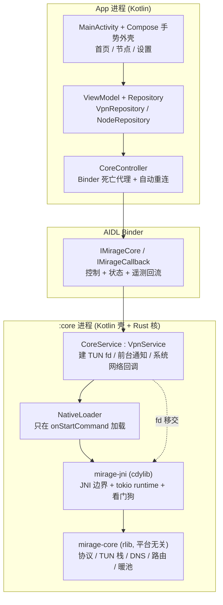

# System architecture

三层架构，边界由**进程**与**语言**双重划开：UI 在主进程写 Kotlin，网络在 `:core` 进程跑 Rust，中间只有 AIDL。

## 职责边界

| 层 | 负责 | 明确不负责 |
|---|---|---|
| App 进程 | 渲染、用户意图、配置持久化 | 任何网络判定 |
| `:core` 壳 | `VpnService.Builder.establish()` 建 fd、前台服务、系统回调 | 健康判定、选路（已下沉，见 [[network-policy-offload]]） |
| `mirage-jni` | JNI 符号面、runtime 生命周期、崩溃隔离 | 协议细节 |
| `mirage-core` | 协议、smoltcp TUN 栈、DNS、路由、暖池 | 一切平台 API |

## 三条不可动摇的结构事实

1. **内核拿不到 TUN fd。** `VpnService.Builder.establish()` 是框架 API，必须由应用上下文调用。可达上限是「应用建 fd、移交内核」，这就是现状。绕开 VpnService 的方案在 Android 上不存在。
2. **`:core` 必须是独立进程。** 见 [[core-separate-process]]。UI 崩溃或退出不得影响隧道。
3. **`vendor/` 不参与编译。** 见 [[vendor-not-compiled]]——比对协议行为只能看 `native/mirage-core/`。

跨进程调用的查询路径一律要能在原生库未加载时返回安全默认值，见 [[native-loader-start-path-only]]。
