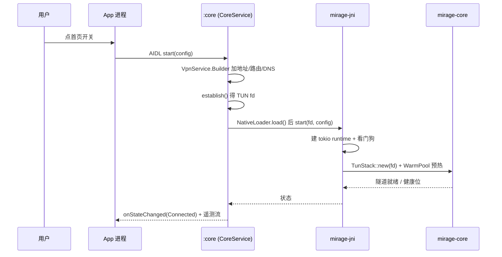
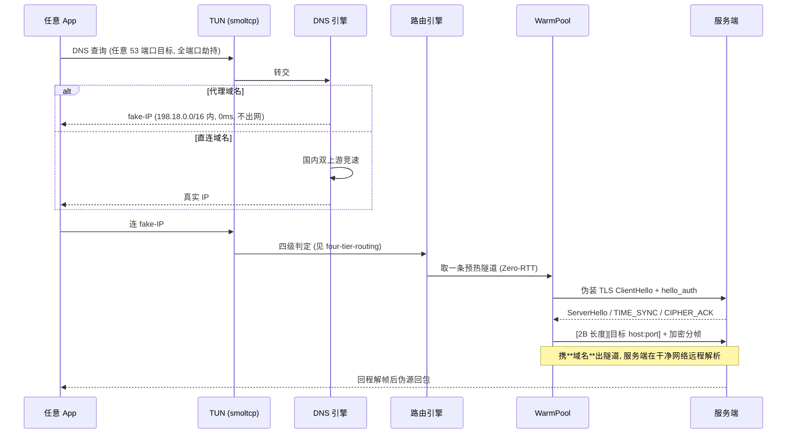

# Key flows

一次「点开关 → 某 App 访问境外站点」的完整路径。两段分开看：**启动**与**数据面**。

## 启动

`NativeLoader.load()` **只在 `onStartCommand` 里跑**，所以仅 bind 不 start 时任何原生查询都走安全默认值（[[native-loader-start-path-only]]）。

## 数据面

要点：

- **fake-IP 反查域名后随隧道上行**，服务端远程解析——这是抗 DNS 污染的根，不是单纯「加密 DNS」。
- **Zero-RTT 来自暖池**，不是协议特性：池里已握完手，新连接直接发目标头。
- 网络切换（Wi-Fi↔蜂窝）靠 stale 探测 + 首写重试兜底；移动端裁掉了 netlink 监听。
- 路由/DNS/健康判定全在内核，壳只建 fd 与执行重启（[[network-policy-offload]]）。
