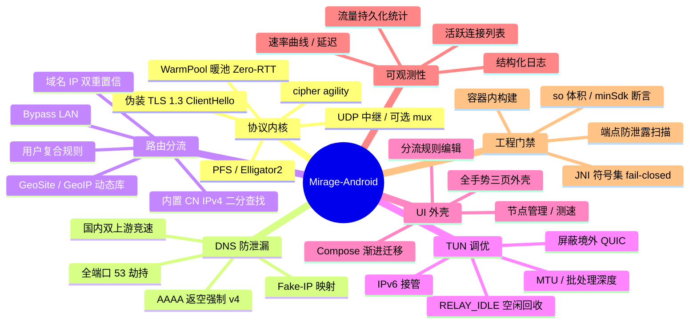

# Feature mindmap

## 读图提示

- 左半（协议 / DNS / 路由 / TUN）全在 `mirage-core`，平台无关，是 iOS 复用的那部分。
- 右半（UI / 可观测性 / 门禁）是 Android 特有的壳与工程面。
- 「工程门禁」不是装饰：端点扫描与 JNI 符号门禁都是 **fail-closed 硬门禁**，见 [[endpoint-leak-gate]] 与 [[jni-symbol-gate]]。
