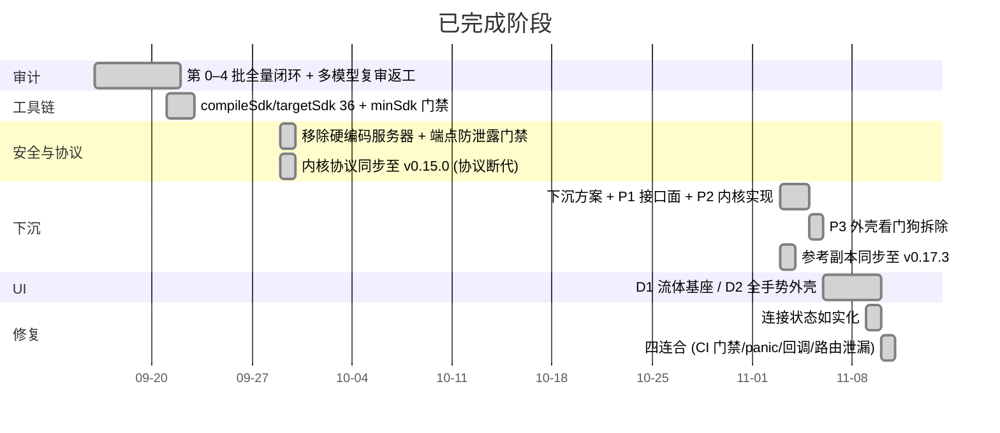

# Roadmap

进度以 git 历史与 `docs/` 中的实测记录为准，日期取自实际提交日。**未来项无排期**——仓库里不存在日期承诺，不替用户编。

## 在途（PR 已开，未合）

| PR | 内容 | 阻塞点 |
|---|---|---|
| #30 | UI S2 — 上滑面板吞吐曲线、请求流列表、嵌套滚动契约 | 与 #32 同改 `MainActivity.kt`，互相冲突 |
| #32 | UI S3 — 分流规则页 Compose 化 | **有明确未复验项**：`shellNavEnabled` 导航锁、拖拽重排、CRUD、应用按钮只做了渲染验证 |

两者必须定序合并，且 #32 合前需接真机回归，见 [[stacked-pr-merge-protocol]]。

## 计划（无排期，按价值排序）

1. **UI S4 / S5** — 设置子面板吸收 `SettingsActivity`；删 `ViewPager2` 依赖、`activity_main.xml` 与遗留 View 岛。方案在 `docs/UI_REDESIGN_PROPOSAL.md`。
2. **恢复今日 / 本月用量显示** — `TrafficStatsStore` 每 30s 在写，唯一读者随旧 `HomeFragment` 一起死了。改动落在 #30 内部。
3. **targetSdk 37 准备** — `ACCESS_LOCAL_NETWORK` 权限、导入 `.so` 需 `setReadOnly()`、CT 默认开启、NDK 升级以拿 `android_getnetworkblockedreason`。
4. **清理技术债** — 5 个死 AIDL 方法、错误码 `-1`/`-5` 合并多种成因、`MirageNative.version()` 报参考副本版本而非编译版本（见 [[vendor-not-compiled]]）。
5. **CI 覆盖缺口** — `pull_request.branches` 只覆盖 `main`/`master`（非 main 基线 PR 无门禁）；`clippy --lib` 从不 lint 测试代码；`native/mirage-core/` 约 90 条 CJK 字面量未纳入扫描。
6. **`tls_padding` 可选开关** — 优先级低：收端恒剥零、上游默认也关，属缺一个 opt-in，不是互通或指纹问题。
7. **iOS 移植** — `mirage-core` 已为此保持平台无关，但是否真做**未确认**，见 `background` 的低置信段。
